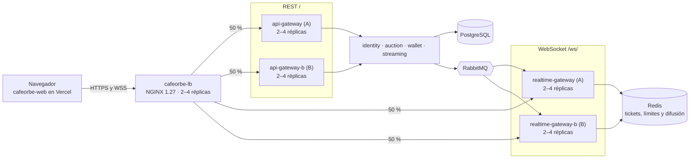

# Balanceador de carga · Azure Load Balancer con dos máquinas virtuales (restricción tecnológica de DIS-01)

## Decisión

CaféOrbe usa un **Azure Load Balancer** (`cafeorbe-lb`, SKU Standard) creado y configurado por el equipo como
único punto de entrada del navegador. Reparte las conexiones entre **dos máquinas virtuales** con NGINX
(`cafeorbe-lb-vm1` y `cafeorbe-lb-vm2`), que terminan TLS y reenvían REST a api-gateway y WebSocket a
realtime-gateway. No es el reparto automático del ingreso de Container Apps ni corre en un contenedor.

```mermaid
flowchart LR
    web["Navegador<br/>cafeorbe-web en Vercel"] -->|"HTTPS y WSS :443"| lb["Azure Load Balancer cafeorbe-lb<br/>IP pública cafeorbe-lb-ip<br/>sonda HTTP /lb/salud cada 5 s"]
    lb --> vm1["VM 1 · NGINX<br/>cafeorbe-lb-vm1"]
    lb --> vm2["VM 2 · NGINX<br/>cafeorbe-lb-vm2"]
    vm1 & vm2 -->|"/ws/*"| rt["realtime-gateway<br/>2–4 réplicas"]
    vm1 & vm2 -->|"/*"| api["api-gateway<br/>2–4 réplicas"]
# Balanceador de carga Azure Front Door · restricción tecnológica de DIS-01

## Decisión

CaféOrbe usa **Azure Front Door (Standard)** como balanceador de carga explícito: un recurso propio de Azure
(`cafeorbe-fd`), creado y configurado por el equipo, que es el único punto de entrada del navegador. No es el
reparto automático del ingreso de Container Apps: Front Door decide a qué instancia va cada petición según
los orígenes, pesos y sondas que define [`scripts/front-door.sh`](../scripts/front-door.sh).

```mermaid
flowchart LR
    web["Navegador<br/>cafeorbe-web en Vercel"] -->|"HTTPS y WSS"| fd["Azure Front Door<br/>cafeorbe-fd · endpoint cafeorbe"]
    subgraph ogapi["og-api · ruta /*"]
        a1["api-a<br/>api-gateway"]
        b1["api-b<br/>api-gateway-b"]
    end
    subgraph ogws["og-ws · ruta /ws/*"]
        a2["realtime-a<br/>realtime-gateway (2–4 réplicas)"]
        b2["realtime-b<br/>realtime-gateway-b (2–4 réplicas)"]
    end
    fd -->|"peso 500"| a1
    fd -->|"peso 500"| b1
    fd -->|"peso 500"| a2
    fd -->|"peso 500"| b2
    a1 & b1 --> svc["identity · auction · wallet · streaming"]
    a2 & b2 --> rd[("Redis<br/>tickets, límites y difusión")]
```

## Configuración

| Elemento | Valor |
|---|---|
| Balanceador | `cafeorbe-lb`, Standard, capa 4 (TCP), región East US 2 |
| Frontend | IP pública estática `cafeorbe-lb-ip` con nombre `cafeorbe-lb.eastus2.cloudapp.azure.com` |
| Backend pool | `vms`: `cafeorbe-lb-vm1` y `cafeorbe-lb-vm2` (Ubuntu 24.04, Standard_D2s_v3, sin IP pública) |
| Reglas | `tcp-443` (HTTPS y WebSocket) y `tcp-80` (reto de Let's Encrypt y redirección a HTTPS); reparto por conexión (hash de 5 tuplas), 30 min de inactividad máxima y reinicio TCP al expirar |
| Sonda de salud | `salud`: HTTP `GET /lb/salud` en el puerto 80 cada 5 s; 2 fallos seguidos sacan a la VM del reparto |
| Salida | Regla `salida`: las VMs salen a Internet (Container Apps, paquetes, Let's Encrypt) por la IP del balanceador |
| Seguridad de red | `cafeorbe-lb-nsg`: solo entran 80 y 443 desde Internet |
| TLS | Certificado de Let's Encrypt para el nombre del balanceador, en cada VM |
| NGINX | `/ws/` → realtime-gateway (WebSocket, 1 h); `/` → api-gateway; cabecera `X-CafeOrbe-VM` con la VM que atendió; log JSON sin cadena de consulta (el ticket del WebSocket no queda registrado, SEG-04) |
| IP del cliente | El balanceador es de capa 4 y no oculta la IP del cliente; NGINX la envía en `X-Forwarded-For` a las auditorías de SEG-01 a SEG-05 |

Archivos: [`scripts/balanceador-azure.sh`](../scripts/balanceador-azure.sh),
[`balanceador-vm/cafeorbe-http.conf`](../balanceador-vm/cafeorbe-http.conf) y
[`balanceador-vm/cafeorbe-https.conf.template`](../balanceador-vm/cafeorbe-https.conf.template).

## Desplegar y probar

```bash
./scripts/balanceador-azure.sh crear      # 10–20 min
./scripts/balanceador-azure.sh probar     # reparto por VM, WebSocket y CORS
./scripts/balanceador-azure.sh estado
```

Después, en Vercel (`cafeorbe-web` → Settings → Environment Variables, Production) y Redeploy sin caché:
`VITE_API_URL=https://cafeorbe-lb.eastus2.cloudapp.azure.com` y `VITE_WS_URL=wss://cafeorbe-lb.eastus2.cloudapp.azure.com`.

**Demostración de tolerancia a fallos del balanceador:** `./scripts/balanceador-azure.sh apagar-vm 1`; en ~10 s
la sonda saca a la VM 1 y todas las conexiones nuevas van a la VM 2 (`probar` lo muestra).
`encender-vm 1` la devuelve al reparto.

**Para volver atrás:** URL directas en Vercel y `./scripts/balanceador-azure.sh borrar`.

## Dónde se ve en el portal

**Equilibradores de carga → cafeorbe-lb**: *Configuración de IP de front-end*, *Grupos de back-end* (las dos
VMs y su estado), *Sondeos de estado*, *Reglas de equilibrio de carga* y *Métricas* (disponibilidad de la
sonda por VM y bytes por VM).

## Antecedentes

- **Azure Front Door** (PR #21): la suscripción *Azure for Students* lo prohíbe (`Free Trial and Student
  account is forbidden for Azure Frontdoor resources`).
- **Application Gateway**: necesita un certificado propio en su escucha HTTPS; descartado por costo y tiempo.
- **NGINX en Container Apps** (PR #20): desplegado y retirado por una caída de conexiones sin causa
  confirmada durante la carga de REN-01.

## Despliegue y pruebas en QA (17 nov 2026)

Creado con `./scripts/balanceador-azure.sh crear` y `certificados`. Hallazgos durante el despliegue:

- La suscripción *Azure for Students* solo permite East US 2, East US, Central US y South Central US
  (`RequestDisallowedByAzure` en el resto), y en esas regiones **no había capacidad** de los tamaños B
  (`SkuNotAvailable` para B1s, B1ms, B2s, B2ats_v2 y B2s_v2). Las VMs son **Standard_D2s_v3** (2 vCPU, 8 GiB,
  ~US$0,10/h cada una).
- Git Bash en Windows convierte argumentos como `/lb/salud` en rutas de disco y dejó la sonda en una ruta
  inexistente (ambas VMs fuera del reparto). El script ahora fija `MSYS_NO_PATHCONV=1`.

`./scripts/balanceador-azure.sh probar`:

| Prueba | Resultado |
|---|---|
| 20 lecturas HTTPS a `/actuator/health/readiness` | 20/20 con 200: 7 `cafeorbe-lb-vm1` y 13 `cafeorbe-lb-vm2` (reparto por conexión) |
| Handshake de WebSocket sin ticket | 400 del realtime-gateway (la ruta `/ws/` llega al servicio) |
| CORS desde `https://cafeorbe-web.vercel.app` | 204 con `Access-Control-Allow-Origin` correcto |
| Certificado | Let's Encrypt válido para `cafeorbe-lb.eastus2.cloudapp.azure.com` en las dos VMs |

**Tolerancia a fallos del balanceador** (`apagar-vm 1` a las 10:18:33, VM detenida a las 10:19:09):

| Prueba | Resultado |
|---|---|
| 30 lecturas con la VM 1 apagada | **30/30 con 200, todas atendidas por `cafeorbe-lb-vm2`** |
| `encender-vm 1` (10:19:39) | La VM 1 vuelve a recibir tráfico a las 10:19:49 |
| Perfil | `cafeorbe-fd`, SKU `Standard_AzureFrontDoor` |
| Endpoint | `cafeorbe` (dominio `*.azurefd.net` que imprime `crear`) |
| Rutas | `ruta-ws`: `/ws/*` → `og-ws` · `ruta-api`: `/*` → `og-api`. Solo HTTPS, sin caché |
| Orígenes | `og-api`: api-gateway (A) y api-gateway-b (B) · `og-ws`: realtime-gateway (A) y realtime-gateway-b (B) |
| Reparto | Prioridad 1 y peso 500 en todos: 50 % a cada instancia (sensibilidad de latencia de 1000 ms, para que la cercanía no rompa el reparto) |
| Sonda de salud | `GET https://<origen>/actuator/health/readiness` cada 10 s; un origen se considera sano con 3 de 4 muestras correctas. Un origen sin salud deja de recibir tráfico |
| Host del origen | Cada origen recibe su propio `Host` y SNI (su FQDN de Container Apps) |
| IP del cliente | Front Door agrega `X-Forwarded-For`; las auditorías de SEG-01 a SEG-05 siguen registrando la IP real |

Las instancias A y B son Container Apps independientes con la misma imagen y configuración. Comparten Redis
(tickets de WebSocket, sesiones cerradas, límites de SEG-03 y difusión de eventos) y la cola de RabbitMQ del
realtime (consumidor único activo), así que un comprador puede caer en cualquiera de las dos. B publica sus
métricas como `api-gateway-b` y `realtime-gateway-b`, para que el tablero y la alerta "Réplica caída" sigan
contando las réplicas de A.
# Balanceador de carga NGINX · restricción tecnológica de DIS-01

## Decisión

CaféOrbe usa un **balanceador de carga NGINX propio** (`cafeorbe-lb`) como único punto de entrada del navegador.
Es una restricción tecnológica de la arquitectura: el backend se escala horizontalmente agregando instancias
detrás del balanceador, y ninguna instancia recibe tráfico del navegador directamente.

La configuración vive en este repositorio ([`balanceador/templates/default.conf.template`](../balanceador/templates/default.conf.template))
y se despliega con [`scripts/balanceador.sh`](../scripts/balanceador.sh). No depende del reparto automático
de Azure: el algoritmo, la salud y la conmutación los define y versiona el equipo.



## Qué hace

| Aspecto | Configuración |
|---|---|
| Rutas | `/ws/` → realtime-gateway A/B (WebSocket, 1 h de inactividad máxima) · todo lo demás → api-gateway A/B |
| Algoritmo | Reparto uniforme por petición: `split_clients` sobre `$request_id`, 50 % a cada instancia |
| Salud | Pasiva: 2 fallos de conexión en 15 s sacan a la instancia durante 15 s (`max_fails=2 fail_timeout=15s`) |
| Conmutación | Si la instancia elegida no responde (502/503), la petición pasa a la otra. Ante un tiempo agotado (504) solo se reintentan lecturas (GET, HEAD, OPTIONS), para no duplicar escrituras |
| Conexión a las instancias | HTTPS con SNI y `Host` de cada instancia; tiempo límite de conexión de 2 s |
| Trazabilidad | Cabecera `X-CafeOrbe-Instancia` (`api-a`, `api-b`, `realtime-a`, `realtime-b`) y log JSON por petición con instancia, estado, duración y `correlationId` |
| Seguridad | `X-Forwarded-For` conserva la IP del cliente (la usan las auditorías de SEG-01 a SEG-05); el log guarda la ruta sin la cadena de consulta, así que el ticket del WebSocket nunca queda registrado (SEG-04) |
| Sonda propia | `GET /lb/salud` → `UP` |

Las instancias A y B son Container Apps independientes con la misma imagen y configuración. Comparten Redis
(tickets de WebSocket, sesiones cerradas, límites de SEG-03 y difusión de eventos entre réplicas) y la cola de
RabbitMQ del realtime (consumidor único activo), así que un comprador puede caer en cualquiera de las dos.

## Desplegar en QA (Azure Cloud Shell)

```bash
cd ~/cafeorbe-infra && git pull
./scripts/front-door.sh crear     # instancias B, perfil, endpoint, grupos de orígenes, orígenes y rutas
./scripts/front-door.sh estado    # orígenes, pesos, sondas y estado de las rutas
./scripts/front-door.sh probar    # repetir hasta ver 200: la propagación tarda 5–20 min
```

Después, en Vercel (`cafeorbe-web` → Settings → Environment Variables, entorno Production) y Redeploy sin caché:

| Variable | Valor |
|---|---|
| `VITE_API_URL` | `https://<endpoint>.azurefd.net` |
| `VITE_WS_URL` | `wss://<endpoint>.azurefd.net` |

Después de cada despliegue de api-gateway o realtime-gateway (los pipelines solo actualizan A):
`./scripts/front-door.sh sincronizar`.

Para volver atrás: restaurar en Vercel las URL directas de api-gateway y realtime-gateway, y
`./scripts/front-door.sh borrar`.

## Dónde se ve en el portal

**Front Door y CDN → cafeorbe-fd**: *Front Door manager* (endpoint, rutas, grupos de orígenes), *Origin groups*
(orígenes A/B con peso y sonda) y *Métricas* (peticiones, latencia y porcentaje de salud por origen).

## Límites conocidos

- La propagación de cambios en Front Door tarda minutos; no sirve para cambiar pesos en vivo.
- La sonda detecta una instancia completa caída. La caída de una réplica dentro de una instancia la sigue
  resolviendo el ingreso de Container Apps de esa instancia (es lo que mide la prueba de caos de DIS-01).
- Los pipelines no conocen las instancias B: hay que ejecutar `sincronizar` después de cada despliegue.
- Costo: el perfil Standard se cobra por hora más el tráfico; borrar con `./scripts/front-door.sh borrar` cuando
  no se use.

## Resultado en QA (17 nov 2026): bloqueado por la suscripción

`az afd profile create` respondió **`BadRequest: Free Trial and Student account is forbidden for Azure Frontdoor
resources`**. La suscripción *Azure for Students* no permite Front Door, aunque el proveedor `Microsoft.Cdn` ya
está registrado y la cuenta tiene permisos sobre el grupo de recursos. No se creó ningún recurso de Front Door.

Alternativas evaluadas:

- **Application Gateway v2**: lo permite la suscripción, pero el navegador entra por HTTPS (la web está en
  Vercel) y Application Gateway necesita un certificado propio para su escucha HTTPS. Sin dominio propio, el
  certificado sería autofirmado y el navegador rechazaría las peticiones. Además tarda 20–30 min y cuesta
  ~US$6 por día.
- **Azure Load Balancer y Traffic Manager**: no sirven para Container Apps (el primero balancea máquinas en una
  red virtual; el segundo reparte por DNS y el certificado de cada app no coincide con su nombre).
- **NGINX propio** (PR #20): desplegado y probado, retirado de QA por la caída de conexiones en REN-01.

Queda como balanceador el **ingreso de Azure Container Apps** (Envoy administrado, configurado por el equipo:
ingreso externo, sin afinidad, sondas de readiness cada 2 s y 2–4 réplicas).
./scripts/balanceador.sh crear     # instancias B, imagen NGINX en ACR y Container App cafeorbe-lb
./scripts/balanceador.sh probar    # reparto A/B y ruta del WebSocket
```

Después, en Vercel (proyecto `cafeorbe-web` → Settings → Environment Variables), apuntar la web al balanceador
y volver a desplegar:

| Variable | Valor |
|---|---|
| `VITE_API_URL` | `https://<fqdn de cafeorbe-lb>` |
| `VITE_WS_URL` | `wss://<fqdn de cafeorbe-lb>` |

Los scripts de verificación usan `API_URL` y `WS_URL`; para medir a través del balanceador basta con exportar la
misma URL.

**Después de cada despliegue** de api-gateway o realtime-gateway (los pipelines solo actualizan la instancia A):

```bash
./scripts/balanceador.sh sincronizar
```

Para volver atrás: restaurar las variables de Vercel a las URL directas y `./scripts/balanceador.sh borrar`.

## Verificación local (17 nov 2026)

Imagen construida con Docker y ejecutada en local contra QA:

| Prueba | Resultado |
|---|---|
| `nginx -t` | Sintaxis correcta |
| 20 lecturas a `/actuator/health/readiness` | 10 a `api-a` y 10 a `api-b`, todas 200 |
| `GET /api/subastas` sin sesión | 401 del api-gateway (la petición llega al servicio) |
| Handshake de WebSocket sin ticket | 400 del realtime-gateway (la ruta `/ws/` llega al servicio) |
| Instancia B apagada: 12 lecturas | 12/12 respondidas por `api-a`, 0 errores |
| Instancia B apagada: 6 POST y 6 handshakes | Todos llegan al servicio por la instancia A, 0 errores del balanceador |

En la prueba local A y B apuntaban al mismo servicio de QA; la prueba en Azure, con instancias separadas, se
hace con `./scripts/balanceador.sh probar`.

## Despliegue en QA (17 nov 2026)

`./scripts/balanceador.sh crear` desde Azure Cloud Shell. Configuración resultante (`estado`):

| App | Imagen | CPU por réplica | Réplicas |
|---|---|---|---|
| `cafeorbe-lb` | `cafeorbe-lb:20261117T115540Z` | 0,25 | 2–4 |
| `api-gateway` (A) | `api-gateway:6f94fe1b` | 0,25 | 2–4 |
| `api-gateway-b` (B) | `api-gateway:6f94fe1b` | 0,25 | 2–4 |
| `realtime-gateway` (A) | `realtime-gateway:8872738c` | 0,5 | 4–6 |
| `realtime-gateway-b` (B) | `realtime-gateway:8872738c` | 0,5 | 2–4 |

URL del balanceador: `https://cafeorbe-lb.blackbay-48700ead.eastus2.azurecontainerapps.io`.
A y B ejecutan la misma imagen.

`./scripts/balanceador.sh probar`:

| Prueba | Resultado |
|---|---|
| 40 lecturas a `/actuator/health/readiness` | 40/40 con 200: 16 `api-a` y 24 `api-b` (reparto aleatorio por petición; con 40 muestras la diferencia es normal) |
| Handshake de WebSocket sin ticket | 400 del realtime-gateway (la ruta llega al servicio; no es un 5xx del balanceador) |

### Carga de REN-01 a través del balanceador y retiro (17 nov 2026)

Con la web apuntando al balanceador, una puja manual en dos pestañas se aceptó y el precio se actualizó en ambas.
La carga de 200 WebSockets de REN-01 (`carga-sala.mjs`, subasta de 3 min) **no llegó a medir**: abrió 163 de
200 conexiones. Las 75 primeras abrieron bien; entre la 75 y la 100 se perdieron 37 de golpe (5 abiertas se
cortaron con 1006 y las nuevas de ese momento no abrieron), y de la 100 a la 200 abrieron todas. No hubo
reinicios ni réplicas nuevas en `cafeorbe-lb`, `realtime-gateway` ni `realtime-gateway-b`.

**Causa sin confirmar.** Hipótesis por revisar en Log Analytics (estado de `/ws/` por instancia y errores de
NGINX entre 12:24 y 12:30 UTC): la conmutación de un handshake a la otra instancia reutiliza el ticket de un
solo uso que la primera ya consumió.

Por tiempo, antes de la presentación el equipo **retiró el balanceador**: se borraron `cafeorbe-lb`,
`api-gateway-b` y `realtime-gateway-b`, y la web volvió a las URL directas (comprobado en el build publicado
a las 12:38 UTC). Se vuelve a desplegar con `./scripts/balanceador.sh crear`.

## Límites conocidos

- NGINX de código abierto solo tiene salud pasiva: detecta una instancia caída por los fallos de las
  peticiones reales y no por sondas propias. La petición que descubre la falla se reenvía a la otra instancia.
- El reparto es por petición, no por usuario: un WebSocket queda en la instancia donde se abrió y, al
  reconectarse, puede caer en la otra. Funciona porque el estado compartido está en Redis.
- El balanceador corre como Container App, así que delante de él queda el ingreso de Azure (TLS público).
  El reparto entre instancias lo decide NGINX.
- Los pipelines no conocen las instancias B: hay que ejecutar `sincronizar` después de cada despliegue.
