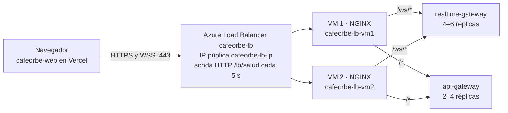

# Balanceador de carga · Azure Load Balancer con dos máquinas virtuales (restricción tecnológica de DIS-01)

## Decisión

CaféOrbe usa un **Azure Load Balancer** (`cafeorbe-lb`, SKU Standard) creado y configurado por el equipo como
único punto de entrada del navegador. Reparte las conexiones entre **dos máquinas virtuales** con NGINX
(`cafeorbe-lb-vm1` y `cafeorbe-lb-vm2`), que terminan TLS y reenvían REST a api-gateway y WebSocket a
realtime-gateway. No es el reparto automático del ingreso de Container Apps ni corre en un contenedor.



## Configuración

| Elemento | Valor |
|---|---|
| Balanceador | `cafeorbe-lb`, Standard, capa 4 (TCP), región East US 2 |
| Frontend | IP pública estática `cafeorbe-lb-ip` con nombre `cafeorbe-lb.eastus2.cloudapp.azure.com` |
| Backend pool | `vms`: `cafeorbe-lb-vm1` y `cafeorbe-lb-vm2` (Ubuntu 24.04, Standard_D2s_v3, sin IP pública) |
| Reglas | `tcp-443` (HTTPS y WebSocket) y `tcp-80` (reto de Let's Encrypt y redirección a HTTPS); reparto por conexión (hash de 5 tuplas), 30 min de inactividad máxima y reinicio TCP al expirar |
| Sonda de salud | `salud`: HTTP `GET /lb/salud` en el puerto 80 cada 5 s; 2 fallos seguidos sacan a la VM del reparto |
| Salida | Regla `salida`: las VMs salen a Internet (Container Apps, paquetes, Let's Encrypt) por la IP del balanceador |
| Seguridad de red | `cafeorbe-lb-nsg`: solo entran 80 y 443 desde Internet |
| TLS | Certificado de Let's Encrypt para el nombre del balanceador, en cada VM |
| NGINX | `/ws/` → realtime-gateway (WebSocket, 1 h); `/` → api-gateway; cabecera `X-CafeOrbe-VM` con la VM que atendió; log JSON sin cadena de consulta (el ticket del WebSocket no queda registrado, SEG-04) |
| IP del cliente | El balanceador es de capa 4 y no oculta la IP del cliente; NGINX la envía en `X-Forwarded-For` a las auditorías de SEG-01 a SEG-05 |

Archivos: [`scripts/balanceador-azure.sh`](../scripts/balanceador-azure.sh),
[`balanceador-vm/cafeorbe-http.conf`](../balanceador-vm/cafeorbe-http.conf) y
[`balanceador-vm/cafeorbe-https.conf.template`](../balanceador-vm/cafeorbe-https.conf.template).

## Desplegar y probar

```bash
./scripts/balanceador-azure.sh crear      # 10–20 min
./scripts/balanceador-azure.sh probar     # reparto por VM, WebSocket y CORS
./scripts/balanceador-azure.sh estado
```

Después, en Vercel (`cafeorbe-web` → Settings → Environment Variables, Production) y Redeploy sin caché:
`VITE_API_URL=https://cafeorbe-lb.eastus2.cloudapp.azure.com` y `VITE_WS_URL=wss://cafeorbe-lb.eastus2.cloudapp.azure.com`.

**Demostración de tolerancia a fallos del balanceador:** `./scripts/balanceador-azure.sh apagar-vm 1`; en ~10 s
la sonda saca a la VM 1 y todas las conexiones nuevas van a la VM 2 (`probar` lo muestra).
`encender-vm 1` la devuelve al reparto.

### Cambiar de QA a PROD

1. Confirmar el despliegue de los seis servicios en PROD, sus pruebas de humo y las seis sondas de readiness. Verificar PostgreSQL `cafeorbe-pg-prod`, el vhost de PROD y Redis `cafeorbe-redis-prod` donde corresponda.
2. Fijar `OTLP_METRICS_ENABLED=false` en el ambiente QA de GitHub y en las Container Apps de QA. Confirmar que solo PROD alimenta el tablero técnico y la alerta «Réplica caída».
3. En una ventana sin cargas activas, ejecutar el cambio y la prueba:

   ```bash
   ./scripts/balanceador-azure.sh destino prod
   ./scripts/balanceador-azure.sh probar
   ```

El cambio valida los FQDN y el readiness de ambos gateways antes de recargar NGINX. Las VMs se actualizan una por vez y pueden apuntar temporalmente a ambientes distintos. Comprobar HTTP 200 y el ambiente `prod` en las lecturas de ambas VMs, además del HTTP 400 de WebSocket sin ticket y el HTTP 204 de CORS desde Vercel. Las URL públicas de Vercel se conservan.

Para volver a QA, ejecutar `destino qa`, repetir `probar` y restablecer el ajuste de métricas de QA si se vuelve a usar ese ambiente para la demostración. Si el ajuste falla a mitad, ejecutar explícitamente el destino anterior en ambas VMs y comprobar el reparto.

## Dónde se ve en el portal

**Equilibradores de carga → cafeorbe-lb**: *Configuración de IP de front-end*, *Grupos de back-end* (las dos
VMs y su estado), *Sondeos de estado*, *Reglas de equilibrio de carga* y *Métricas* (disponibilidad de la
sonda por VM y bytes por VM).

## Antecedentes

- **Azure Front Door** (PR #21): la suscripción *Azure for Students* lo prohíbe (`Free Trial and Student
  account is forbidden for Azure Frontdoor resources`).
- **Application Gateway**: necesita un certificado propio en su escucha HTTPS; descartado por costo y tiempo.
- **NGINX en Container Apps** (PR #20): desplegado y retirado por una caída de conexiones sin causa
  confirmada durante la carga de REN-01.

## Despliegue y pruebas en QA (17 nov 2026)

Creado con `./scripts/balanceador-azure.sh crear` y `certificados`. Hallazgos durante el despliegue:

- La suscripción *Azure for Students* solo permite East US 2, East US, Central US y South Central US
  (`RequestDisallowedByAzure` en el resto), y en esas regiones **no había capacidad** de los tamaños B
  (`SkuNotAvailable` para B1s, B1ms, B2s, B2ats_v2 y B2s_v2). Las VMs son **Standard_D2s_v3** (2 vCPU, 8 GiB,
  ~US$0,10/h cada una).
- Git Bash en Windows convierte argumentos como `/lb/salud` en rutas de disco y dejó la sonda en una ruta
  inexistente (ambas VMs fuera del reparto). El script ahora fija `MSYS_NO_PATHCONV=1`.

`./scripts/balanceador-azure.sh probar`:

| Prueba | Resultado |
|---|---|
| 20 lecturas HTTPS a `/actuator/health/readiness` | 20/20 con 200: 7 `cafeorbe-lb-vm1` y 13 `cafeorbe-lb-vm2` (reparto por conexión) |
| Handshake de WebSocket sin ticket | 400 del realtime-gateway (la ruta `/ws/` llega al servicio) |
| CORS desde `https://cafeorbe-web.vercel.app` | 204 con `Access-Control-Allow-Origin` correcto |
| Certificado | Let's Encrypt válido para `cafeorbe-lb.eastus2.cloudapp.azure.com` en las dos VMs |

**Tolerancia a fallos del balanceador** (`apagar-vm 1` a las 10:18:33, VM detenida a las 10:19:09):

| Prueba | Resultado |
|---|---|
| 30 lecturas con la VM 1 apagada | **30/30 con 200, todas atendidas por `cafeorbe-lb-vm2`** |
| `encender-vm 1` (10:19:39) | La VM 1 vuelve a recibir tráfico a las 10:19:49 |

La prueba de REN-01 del enfoque anterior (NGINX en Container Apps, [PR #20](https://github.com/CafeOrbe/cafeorbe-infra/pull/20)) abrió 163 de 200 conexiones. Se perdieron 37 conexiones y la corrida no certificó REN-01. La causa quedó sin confirmar. El [PR #21](https://github.com/CafeOrbe/cafeorbe-infra/pull/21) conserva el intento de Front Door y el rechazo de la suscripción.

## Evidencia de PROD

Los PR de configuración de despliegue y aprovisionamiento están integrados. La etiqueta `v1.0.0` se publicó en los seis repositorios. GitHub Actions espera la revisión del ambiente `PROD` antes de ejecutar `deploy-prod`. Quedan pendientes la prueba de humo, el readiness y las corridas a través del balanceador. Las mediciones anteriores corresponden a QA.
