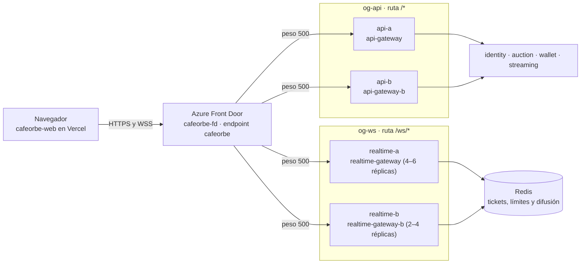

# Balanceador de carga Azure Front Door · restricción tecnológica de DIS-01

## Decisión

CaféOrbe usa **Azure Front Door (Standard)** como balanceador de carga explícito: un recurso propio de Azure
(`cafeorbe-fd`), creado y configurado por el equipo, que es el único punto de entrada del navegador. No es el
reparto automático del ingreso de Container Apps: Front Door decide a qué instancia va cada petición según
los orígenes, pesos y sondas que define [`scripts/front-door.sh`](../scripts/front-door.sh).



## Configuración

| Elemento | Valor |
|---|---|
| Perfil | `cafeorbe-fd`, SKU `Standard_AzureFrontDoor` |
| Endpoint | `cafeorbe` (dominio `*.azurefd.net` que imprime `crear`) |
| Rutas | `ruta-ws`: `/ws/*` → `og-ws` · `ruta-api`: `/*` → `og-api`. Solo HTTPS, sin caché |
| Orígenes | `og-api`: api-gateway (A) y api-gateway-b (B) · `og-ws`: realtime-gateway (A) y realtime-gateway-b (B) |
| Reparto | Prioridad 1 y peso 500 en todos: 50 % a cada instancia (sensibilidad de latencia de 1000 ms, para que la cercanía no rompa el reparto) |
| Sonda de salud | `GET https://<origen>/actuator/health/readiness` cada 10 s; un origen se considera sano con 3 de 4 muestras correctas. Un origen sin salud deja de recibir tráfico |
| Host del origen | Cada origen recibe su propio `Host` y SNI (su FQDN de Container Apps) |
| IP del cliente | Front Door agrega `X-Forwarded-For`; las auditorías de SEG-01 a SEG-05 siguen registrando la IP real |

Las instancias A y B son Container Apps independientes con la misma imagen y configuración. Comparten Redis
(tickets de WebSocket, sesiones cerradas, límites de SEG-03 y difusión de eventos) y la cola de RabbitMQ del
realtime (consumidor único activo), así que un comprador puede caer en cualquiera de las dos. B publica sus
métricas como `api-gateway-b` y `realtime-gateway-b`, para que el tablero y la alerta "Réplica caída" sigan
contando las réplicas de A.

## Desplegar en QA (Azure Cloud Shell)

```bash
cd ~/cafeorbe-infra && git pull
./scripts/front-door.sh crear     # instancias B, perfil, endpoint, grupos de orígenes, orígenes y rutas
./scripts/front-door.sh estado    # orígenes, pesos, sondas y estado de las rutas
./scripts/front-door.sh probar    # repetir hasta ver 200: la propagación tarda 5–20 min
```

Después, en Vercel (`cafeorbe-web` → Settings → Environment Variables, entorno Production) y Redeploy sin caché:

| Variable | Valor |
|---|---|
| `VITE_API_URL` | `https://<endpoint>.azurefd.net` |
| `VITE_WS_URL` | `wss://<endpoint>.azurefd.net` |

Después de cada despliegue de api-gateway o realtime-gateway (los pipelines solo actualizan A):
`./scripts/front-door.sh sincronizar`.

Para volver atrás: restaurar en Vercel las URL directas de api-gateway y realtime-gateway, y
`./scripts/front-door.sh borrar`.

## Dónde se ve en el portal

**Front Door y CDN → cafeorbe-fd**: *Front Door manager* (endpoint, rutas, grupos de orígenes), *Origin groups*
(orígenes A/B con peso y sonda) y *Métricas* (peticiones, latencia y porcentaje de salud por origen).

## Límites conocidos

- La propagación de cambios en Front Door tarda minutos; no sirve para cambiar pesos en vivo.
- La sonda detecta una instancia completa caída. La caída de una réplica dentro de una instancia la sigue
  resolviendo el ingreso de Container Apps de esa instancia (es lo que mide la prueba de caos de DIS-01).
- Los pipelines no conocen las instancias B: hay que ejecutar `sincronizar` después de cada despliegue.
- Costo: el perfil Standard se cobra por hora más el tráfico; borrar con `./scripts/front-door.sh borrar` cuando
  no se use.
