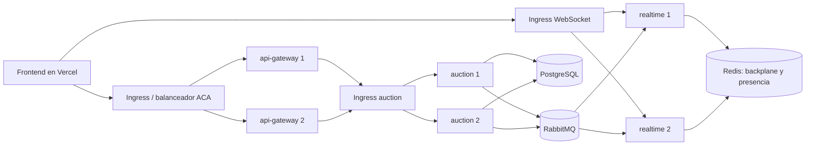

# DIS-01 · Disponibilidad, escalabilidad y tolerancia a fallos

## Escenario

Durante una subasta operan al menos dos réplicas de `api-gateway`, `auction-service` y
`realtime-gateway`. Si una réplica falla, el ingress de Azure Container Apps deja de enviarle tráfico,
las peticiones continúan en las réplicas sanas y los WebSocket afectados se reconectan y resincronizan.
Los servicios pueden crecer hasta cuatro réplicas.

Las medidas de aceptación son:

- cero pujas aceptadas perdidas;
- menos de 2 % de errores durante los 30 segundos posteriores a la falla;
- reconexión en menos de 10 segundos;
- al menos dos réplicas disponibles en los tres servicios críticos;
- con dos réplicas, cada una recibe al menos 30 % de las peticiones;
- exactamente un cierre y un cobro por subasta.

## Tácticas aplicadas



| Riesgo | Táctica |
|---|---|
| Una réplica deja de responder | Sondas HTTP de startup, liveness y readiness; el ingress retira la réplica. |
| Un despliegue cierra WebSockets | Realtime envía cierre 1012; el navegador reconecta con espera y variación aleatoria. |
| Los clientes de realtime quedan repartidos | Redis Pub/Sub difunde cada evento a todas las réplicas. |
| Quedan usuarios fantasma tras una caída abrupta | Presencia en Redis con latido por réplica y TTL. |
| Dos réplicas aceptan la misma puja | `SELECT FOR UPDATE` serializa el cambio en PostgreSQL. |
| Dos réplicas cierran la misma subasta | Bloqueo pesimista con `SKIP LOCKED`. |
| RabbitMQ repite un cobro | Wallet registra los eventos de forma idempotente y tiene restricciones únicas. |
| Una réplica cae durante un evento | Outbox transaccional; la publicación se reintenta sin perder el cambio confirmado. |

## Configuración reproducible

Los pipelines de los tres servicios críticos fijan `min-replicas=2` y `max-replicas=4` en QA y
PROD. La configuración central agrega una regla HTTP de 20 peticiones concurrentes por réplica para
que el servicio crezca ante carga. Para aplicar la configuración a aplicaciones ya desplegadas y
registrar las sondas:

```bash
./scripts/dis-01-configurar.sh qa
./scripts/dis-01-verificar.sh qa
```

`dis-01-configurar.sh` exporta temporalmente la configuración actual de cada Container App, conserva
imagen, variables y recursos, y modifica el escalado, la regla HTTP y las sondas del primer contenedor.
Los temporales tienen permisos `600` y se eliminan al terminar. La verificación toma 60 muestras del
endpoint de métricas de auction y exige observar exactamente dos réplicas con al menos 30 % del tráfico
en cada una.

También existe el workflow manual **DIS-01 · disponibilidad en Azure**. Su artefacto contiene la
topología observada y la salida de la prueba.

## Prueba de caos

La prueba termina PID 1 de una réplica de `auction-service`, consulta una ruta funcional mientras Azure
reemplaza la réplica y falla si el porcentaje de errores llega a 2 %, si no hay una respuesta sana antes
de 10 segundos o si la segunda réplica no reaparece en tres minutos.

```bash
INTERNAL_TOKEN='valor configurado de forma segura' ./scripts/dis-01-caos.sh qa
```

La credencial se proporciona mediante el almacén de secretos de GitHub; el script no la imprime ni la
guarda. Esta prueba valida el balanceador y la recuperación de `auction-service`. Las garantías de una
sola puja ganadora, un solo cierre y un solo cobro están cubiertas por las pruebas de concurrencia e
idempotencia de auction y wallet, que deben ejecutarse junto con esta evidencia.

## Evidencia para la entrega

Conservar:

1. el artefacto del workflow con la configuración y el resultado de caos;
2. una captura de Azure mostrando las réplicas de los tres servicios;
3. las ejecuciones verdes de auction, wallet, realtime, gateway y frontend;
4. el gráfico de métricas por `instancia` durante la falla;
5. la hora de caída, primera respuesta sana y reposición de la réplica.
