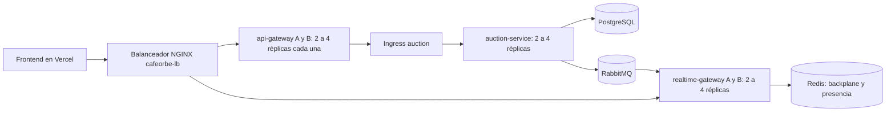

# DIS-01 · Disponibilidad, escalabilidad y tolerancia a fallos

## Escenario

Texto del PDF de escenarios (DIS-01), que es el que se certifica: durante una subasta en curso se
detiene **una de las 2 réplicas** de `auction-service` y **una de las 2** de `realtime-gateway`, o la
carga se duplica. Ambiente: mínimo **2 réplicas** por servicio de entrada y de subasta. Si la carga
sube, se agregan réplicas **hasta 4**.

Configuración: `api-gateway`, `auction-service` y `realtime-gateway` en **2 a 4 réplicas**; auction y
realtime con **0,5 vCPU / 1 GiB** por réplica.

Las medidas de aceptación (PDF) son:

- cero pujas aceptadas perdidas;
- menos de 2 % de errores durante los 30 segundos posteriores a la falla;
- reconexión en menos de 10 segundos;
- con 2 réplicas, al menos 30 % de las peticiones llega a cada una;
- exactamente 1 cierre y 1 cobro por subasta (un evento de cierre, un COBRO y un ABONO_VENTA);
- con la carga duplicada, auction y realtime agregan réplicas hasta 4.

Del 17 al 18 nov 2026 se usaron 4–6 réplicas (ver el historial más abajo). Se volvió a 2–4 para cumplir el
texto del PDF y para liberar núcleos: con 4–6, QA y PROD ocupaban los 10 núcleos de la cuota y el
escalado no se podía demostrar.

## Tácticas aplicadas

**Restricción tecnológica: balanceador de carga NGINX propio (`cafeorbe-lb`).** El navegador solo habla con el
balanceador, que reparte REST entre dos instancias de api-gateway y WebSocket entre dos instancias de
realtime-gateway, saca a la instancia que falla y reenvía la petición a la otra. Configuración, despliegue y
pruebas en [BALANCEADOR.md](BALANCEADOR.md).



| Riesgo | Táctica |
|---|---|
| Una instancia de entrada deja de responder | El balanceador NGINX la saca tras 2 fallos en 15 s y reenvía la petición a la otra instancia (lecturas también ante tiempo agotado). |
| Una réplica deja de responder | Sondas HTTP de startup, liveness y readiness (cada 2 s, 2 fallos). En Express se observó tráfico hacia contenedores que reiniciaban pese a las sondas; con dos réplicas queda una sana al caer la otra, y el cliente web reintenta rápido durante 10 s. |
| Un despliegue cierra WebSockets | Realtime envía cierre 1012; el navegador reconecta con espera y variación aleatoria. |
| Los clientes de realtime quedan repartidos | Redis Pub/Sub difunde cada evento a todas las réplicas. |
| Quedan usuarios fantasma tras una caída abrupta | Presencia en Redis con latido por réplica y TTL. |
| Dos réplicas aceptan la misma puja | `SELECT FOR UPDATE` serializa el cambio en PostgreSQL. |
| Dos réplicas cierran la misma subasta | Bloqueo pesimista con `SKIP LOCKED`. |
| RabbitMQ repite un cobro | Wallet registra los eventos de forma idempotente y tiene restricciones únicas. |
| Una réplica cae durante un evento | Outbox transaccional; la publicación se reintenta sin perder el cambio confirmado. |

## Configuración reproducible

Los pipelines de auction y realtime declaran `--cpu 0.5 --memory 1Gi --min-replicas 2 --max-replicas 4`
en QA y PROD. El configurador central aplica esos mismos recursos y límites a ambos servicios,
mantiene API en 2–4 y agrega la regla HTTP de 20 peticiones concurrentes por réplica y las sondas.
Conserva imágenes, variables y los demás campos de la app. Los temporales tienen permisos `600`
y se eliminan al terminar.

### Presupuesto de conexiones a PostgreSQL

Auction declara además `DB_POOL_MAX=2` en ambos pipelines, el configurador y el encendido. Es la
única variable que el configurador reemplaza deliberadamente; conserva las demás. La prueba real
de escalado encontró un override anterior de 10 por réplica: con seis réplicas podía pedir 60
conexiones y bloquear los nuevos arranques. El PostgreSQL de QA tiene `max_connections=50`, con
15 conexiones reservadas y 35 utilizables por usuarios normales; no se aumentó el servidor.

Con los límites actuales de QA, auction consume como máximo `4 × 2 = 8`; identity, wallet y
streaming usan pools de 3 y máximos de 2 réplicas cada uno (`3 × 2 × 3 = 18`). El máximo conjunto
es 26, dejando nueve conexiones de margen. Recalcular este presupuesto si cambian los pools o
límites de cualquiera de esos servicios; no basta con abrir el máximo de réplicas.

```bash
./scripts/dis-01-configurar.sh qa
INTERNAL_TOKEN='valor resuelto de forma segura' ./scripts/dis-01-verificar.sh qa
```

El verificador comprueba recursos, límites, réplicas listas, sondas y readiness; después registra el
reparto con 60 muestras de auction: con 2 réplicas exige al menos 30 % en cada una. Debe ejecutarse con
el despliegue estabilizado. El workflow manual **DIS-01 · disponibilidad en Azure** aplica y verifica
esta topología. Su paso opcional `scripts/dis-01-caos.sh` es una prueba antigua de auction y no
sustituye la certificación bajo carga de los dos servicios descrita a continuación.

Regresión sin acceso a Azure (Linux con Bash y jq):
`python3 verificacion/dis01/probar-topologia.py`. Simula configurar, verificar y encender,
incluyendo QA/PROD y la preservación de imágenes, variables y recursos de los demás servicios.

`azure-encender.sh` deja auction y realtime en 2–4 con 0,5 vCPU / 1 GiB; API permanece en 2–4 y
los servicios base en 1–2. Cuando el ambiente no esté en uso, ejecutar `scripts/azure-apagar.sh`.
El helper de benchmarking `ren-01-carga.sh preparar` configura temporalmente 2 réplicas de 1 vCPU;
no se utiliza para preparar el escenario DIS-01 actual.

## Prueba de caos bajo carga

Con los secretos resueltos de forma segura, seguir el flujo de
[`verificacion/ren01`](../verificacion/ren01/) y preparar la subasta:

```bash
cd verificacion/ren01
node preparar-ren01.mjs --compradores 60 --minutos 3
export REN01_SUBASTA=$(cat .subasta-ren01)
cd ../dis01
node caos-bajo-carga.mjs --replicas-minimas 2
# Después de que cierre la subasta:
bash verificar-cierre.sh "$REN01_SUBASTA"
```

El generador conecta 60 compradores, mantiene 5 pujas/s y termina PID 1 de una réplica de auction y
una de realtime a los 30 s; observa otros 90 s. Exige un mínimo de dos réplicas al iniciar y al
comprobar reposición y registra el mínimo en el resultado.
La política de reconexión no cambia. Confirmar también dos réplicas listas mediante el sondeo
por réplica: la comprobación del generador cuenta contenedores en marcha y puede ser tardía.

## Evidencia para la entrega

Conservar:

1. el artefacto del workflow con la configuración y el resultado de caos;
2. una captura de Azure mostrando las réplicas de los tres servicios;
3. las ejecuciones verdes de auction, wallet, realtime, gateway y frontend;
4. el gráfico de métricas por `instancia` durante la falla;
5. la hora de caída, primera respuesta sana y reposición de la réplica.

## Estado de la evidencia y escalado pendiente

[`RESULTADO-DIS01.md`](../verificacion/dis01/RESULTADO-DIS01.md) conserva las nueve corridas históricas:
con dos réplicas de 1 vCPU pasaron 2/3; con cuatro fijas de 0,5 vCPU pasaron 6/6 (tres subastas de
10 minutos y tres de 3 minutos). Esas ejecuciones **no certifican el escalado 4→6** ni se realizaron
con la nueva opción `--replicas-minimas`; sus JSON originales se conservan sin alteración.

Para la configuración 2–4 del PDF:

1. registrar recursos, regla HTTP, límites y réplicas listas antes de la carga;
2. repetir el caos a carga base con dos réplicas por servicio, deteniendo una de cada una;
3. **reportar todas las corridas**, también las que no cumplan. Con 2 réplicas de 1 vCPU pasaron 2 de 3:
   el ingreso sigue enviando ≈ 50 % de los intentos a la réplica que reinicia;
4. conservar los JSON, intentos fallidos, reconexiones ≥ 5 s, REST/p95 y tiempos de reposición;
5. verificar al cierre un evento, un COBRO y un ABONO_VENTA;
6. en otra prueba, duplicar la carga y registrar el crecimiento de 2 a 3 o 4 réplicas, con horas,
   cantidades de réplicas y las métricas de carga.

## Repetición en PROD a través del balanceador

Ejecutar después de verificar las seis aplicaciones y el cambio de destino descrito en [BALANCEADOR.md](BALANCEADOR.md). Usar una subasta de 3 minutos y finalizar la carga dentro de esa ventana.

```bash
export MSYS_NO_PATHCONV=1
export API_URL=https://cafeorbe-lb.eastus2.cloudapp.azure.com
export WS_URL=wss://cafeorbe-lb.eastus2.cloudapp.azure.com
CAFEORBE_AMBIENTE=prod node verificacion/dis01/caos-bajo-carga.mjs --antes 30 --despues 90 --replicas-minimas 2
bash verificacion/dis01/verificar-cierre.sh "$REN01_SUBASTA" prod
```

Preparar antes los compradores y exportar `REN01_SUBASTA` con el identificador en PROD. Ejecutar `verificar-cierre.sh` después del cierre de la subasta. Registrar errores REST, reconexión, pujas perdidas, reposición y cierre contable. La verificación de PROD está pendiente.
