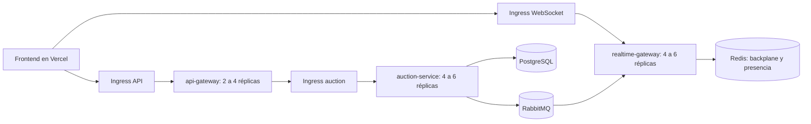

# DIS-01 · Disponibilidad, escalabilidad y tolerancia a fallos

## Escenario

Durante una subasta, `auction-service` y `realtime-gateway` mantienen **4 a 6 réplicas**
de **0,5 vCPU / 1 GiB** cada una. `api-gateway` conserva su rango de **2 a 4**. A carga base se
detiene **1 de las 4 réplicas** de auction y **1 de las 4** de realtime; quedan tres sanas por servicio.
Los WebSocket afectados se reconectan y las operaciones confirmadas se conservan.

Ante carga HTTP concurrente sostenida suficiente, auction y realtime pueden crecer por encima de
cuatro hasta un máximo de seis. Habilitar ese máximo no demuestra el escalado: se debe registrar
la transición bajo carga en una prueba separada de la caída a carga base.

Texto para trasladar al PDF de Sprint 3 (su archivo fuente no está disponible en el workspace):

> Mínimo 4 réplicas de auction-service y realtime-gateway, de 0,5 vCPU y 1 GiB cada una. Durante una
> subasta se detiene una de las cuatro réplicas de cada servicio y se mide continuidad, reconexión,
> reposición y consistencia. Ante mayor carga, cada servicio puede escalar hasta seis réplicas.
> El crecimiento por encima de cuatro se demuestra con una prueba de carga separada.

Las medidas de aceptación son:

- cero pujas aceptadas perdidas;
- menos de 2 % de errores durante los 30 segundos posteriores a la falla;
- reconexión en menos de 10 segundos;
- reposición hasta al menos 4 réplicas por servicio afectado, con reinicio o reemplazo confirmado;
- al verificar la topología estable: 4–6 réplicas listas en auction y realtime, y 2–4 en API;
- observar tráfico en al menos 4 instancias de auction y guardar la distribución;
- para escalabilidad: registrar crecimiento de 4 a 5 o 6 réplicas bajo carga;
- exactamente un evento de cierre, un COBRO y un ABONO_VENTA por subasta.

El antiguo 30 % por instancia correspondía a dos réplicas. Es imposible exigirlo a las cuatro
simultáneamente; las 60 muestras informan la distribución, sin certificar equidad del reparto.

## Tácticas aplicadas



| Riesgo | Táctica |
|---|---|
| Una réplica deja de responder | Sondas HTTP de startup, liveness y readiness (cada 2 s, 2 fallos). En Express se observó tráfico hacia contenedores que reiniciaban pese a las sondas; las cuatro réplicas base conservan tres sanas al caer una. |
| Un despliegue cierra WebSockets | Realtime envía cierre 1012; el navegador reconecta con espera y variación aleatoria. |
| Los clientes de realtime quedan repartidos | Redis Pub/Sub difunde cada evento a todas las réplicas. |
| Quedan usuarios fantasma tras una caída abrupta | Presencia en Redis con latido por réplica y TTL. |
| Dos réplicas aceptan la misma puja | `SELECT FOR UPDATE` serializa el cambio en PostgreSQL. |
| Dos réplicas cierran la misma subasta | Bloqueo pesimista con `SKIP LOCKED`. |
| RabbitMQ repite un cobro | Wallet registra los eventos de forma idempotente y tiene restricciones únicas. |
| Una réplica cae durante un evento | Outbox transaccional; la publicación se reintenta sin perder el cambio confirmado. |

## Configuración reproducible

Los pipelines de auction y realtime declaran `--cpu 0.5 --memory 1Gi --min-replicas 4 --max-replicas 6`
en QA y PROD. El configurador central aplica esos mismos recursos y límites a ambos servicios,
conserva API en 2–4 y agrega la regla HTTP de 20 peticiones concurrentes por réplica y las sondas.
Conserva imágenes, variables y los demás campos de la app. Los temporales tienen permisos `600`
y se eliminan al terminar.

```bash
./scripts/dis-01-configurar.sh qa
INTERNAL_TOKEN='valor resuelto de forma segura' ./scripts/dis-01-verificar.sh qa
```

El verificador comprueba recursos, límites, réplicas listas, sondas y readiness; después registra el
reparto con 60 muestras de auction y exige observar al menos cuatro instancias. Debe ejecutarse con
el despliegue estabilizado. El workflow manual **DIS-01 · disponibilidad en Azure** aplica y verifica
esta topología. Su paso opcional `scripts/dis-01-caos.sh` es una prueba antigua de auction y no
sustituye la certificación bajo carga de los dos servicios descrita a continuación.

Regresión sin acceso a Azure (Linux con Bash y jq):
`python3 verificacion/dis01/probar-topologia.py`. Simula configurar, verificar y encender,
incluyendo QA/PROD y la preservación de imágenes, variables y recursos de los demás servicios.

`azure-encender.sh` conserva auction y realtime en 4–6 con 0,5 vCPU / 1 GiB; API permanece en 2–4 y
los servicios base en 1–2. Cuando el ambiente no esté en uso, ejecutar `scripts/azure-apagar.sh`.
El helper de benchmarking `ren-01-carga.sh preparar` configura temporalmente 2 réplicas de 1 vCPU;
no se utiliza para preparar el escenario DIS-01 actual.

## Prueba de caos bajo carga

Con los secretos resueltos de forma segura, seguir el flujo de
[`verificacion/ren01`](../verificacion/ren01/) y preparar la subasta:

```bash
cd verificacion/ren01
node preparar-ren01.mjs --compradores 60 --minutos 3
export REN01_SUBASTA=$(cat .subasta-ren01)
cd ../dis01
node caos-bajo-carga.mjs --replicas-minimas 4
# Después de que cierre la subasta:
bash verificar-cierre.sh "$REN01_SUBASTA"
```

El generador conecta 60 compradores, mantiene 5 pujas/s y termina PID 1 de una réplica de auction y
una de realtime a los 30 s; observa otros 90 s. Exige un mínimo de cuatro réplicas al iniciar y al
comprobar reposición y registra el mínimo en el resultado. Para reproducir la configuración histórica
de dos réplicas existe `--replicas-minimas 2`; no se usa para certificar el escenario actual.
La política de reconexión no cambia. Confirmar también cuatro réplicas listas mediante el sondeo
por réplica: la comprobación del generador cuenta contenedores en marcha y puede ser tardía.

## Evidencia para la entrega

Conservar:

1. el artefacto del workflow con la configuración y el resultado de caos;
2. una captura de Azure mostrando las réplicas de los tres servicios;
3. las ejecuciones verdes de auction, wallet, realtime, gateway y frontend;
4. el gráfico de métricas por `instancia` durante la falla;
5. la hora de caída, primera respuesta sana y reposición de la réplica.

## Estado de la evidencia y escalado pendiente

[`RESULTADO-DIS01.md`](../verificacion/dis01/RESULTADO-DIS01.md) conserva las nueve corridas históricas:
con dos réplicas de 1 vCPU pasaron 2/3; con cuatro fijas de 0,5 vCPU pasaron 6/6 (tres subastas de
10 minutos y tres de 3 minutos). Esas ejecuciones **no certifican el escalado 4→6** ni se realizaron
con la nueva opción `--replicas-minimas`; sus JSON originales se conservan sin alteración.

Para la nueva configuración:

1. registrar recursos, regla HTTP, límites y réplicas listas antes de la carga;
2. repetir el caos a carga base, con cuatro réplicas antes de detener una por servicio;
3. conservar los JSON, intentos fallidos, reconexiones ≥ 5 s, REST/p95 y tiempos de reposición;
4. verificar al cierre un evento, un COBRO y un ABONO_VENTA;
5. en otra prueba, sostener carga suficiente y registrar el crecimiento por encima de cuatro
   hasta un máximo de seis, con horas, cantidades de réplicas y las métricas de carga;
6. trasladar el texto del escenario al PDF cuando esté disponible.

Abrir el máximo a seis deja margen para demostrar escalabilidad; la aceptación de ese criterio
permanece pendiente hasta ejecutar y conservar la prueba correspondiente.
