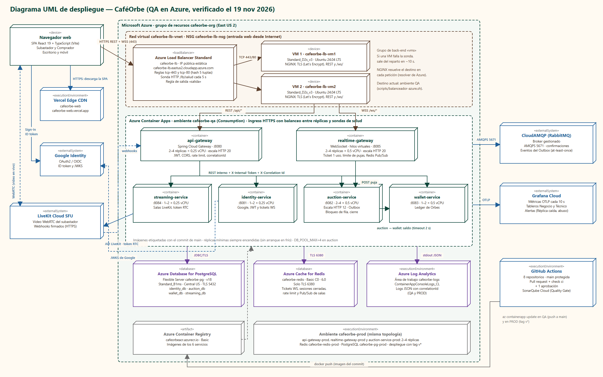

# Diagrama UML de despliegue

Topología de CaféOrbe en QA, verificada contra Azure el 19 nov 2026. Es la Figura 7 del documento de arquitectura (sección 5.7) y la diapositiva 4 de la presentación.



| Archivo | Uso |
|---|---|
| `generar_diagrama.py` | Fuente del diagrama: nodos, conexiones y datos de cada recurso |
| `diagrama-despliegue.svg` | Versión vectorial |
| `diagrama-despliegue.html` | El SVG dentro de una página, para exportar a PNG |
| `diagrama-despliegue.png` | Imagen de 2400 × 1500 para el documento y la presentación |

## Regenerar

1. Editar los datos en `generar_diagrama.py` y ejecutar `python docs/despliegue/generar_diagrama.py`.
2. Exportar a PNG con Edge (PowerShell en Windows):

   ```powershell
   & "C:\Program Files (x86)\Microsoft\Edge\Application\msedge.exe" --headless=new --hide-scrollbars --window-size=2400,1500 --screenshot="$PWD\docs\despliegue\diagrama-despliegue.png" "file:///$($PWD -replace '\\','/')/docs/despliegue/diagrama-despliegue.html"
   ```

## De dónde salen los datos

`az containerapp list`, `az redis list`, `az postgres flexible-server list`, `az network lb show`, `az vm list` y `az acr show` sobre el grupo `cafeorbe-org`. Las conexiones entre servicios salen de las variables de entorno de cada Container App (`REDIS_*`, `RABBIT_*`, `DB_*`, `LIVEKIT_*`, `*_URL`).

Diferencias con el ambiente local (`docker-compose.yml`): en Azure, PostgreSQL es la versión 18 (Central US) y Redis la 6.0; en local son 16 y 7. RabbitMQ usa AMQPS 5671 en CloudAMQP.
